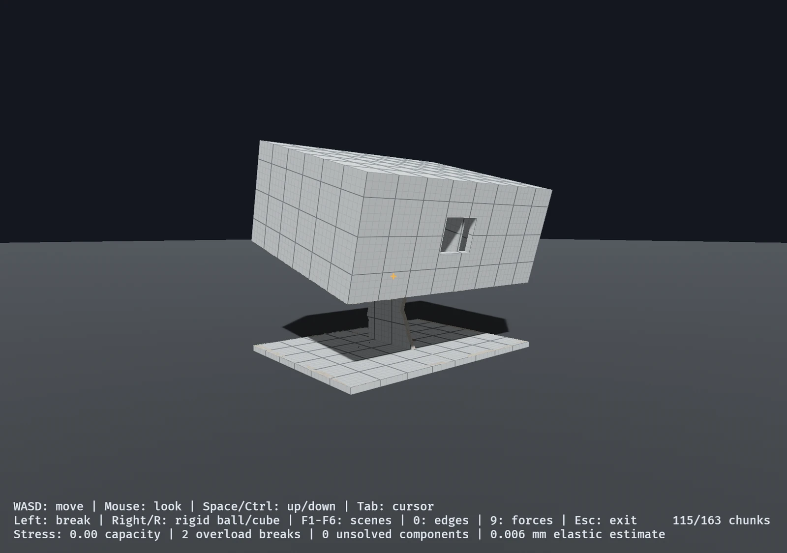

# Bevy Destruction

Bevy Destruction 是基于 Bevy 0.20.1 和 Avian 0.8.0 的建筑破坏插件。它使用 Blender 预破碎资产，在运行时模拟自重过载、撞击断裂和失去支撑后的刚体运动。内置六个演示场景，可交互破坏并查看连接受力。



## 快速开始

在仓库根目录使用 Rust 1.97.1 或以上版本运行。桌面演示需要支持 Bevy 的图形环境。

```powershell
cargo run --locked
cargo run --locked -- --scene highrise_slab
cargo run --locked -- --asset buildings/rectangle.destruction.json
```

默认打开 `rectangle`。使用 `--scene` 指定内置场景，也可在运行中按场景快捷键。

| 按键 | 场景 | 内容 |
| --- | --- | --- |
| F1 | `rectangle` | 两层矩形楼 |
| F2 | `highrise_slab` | 十层板式高楼 |
| F3 | `highrise_l` | 八层 L 形高楼 |
| F4 | `bridge` | 双钢主梁、六桥墩 |
| F5 | `courtyard` | 两层庭院楼 |
| F6 | `l_shape` | 三层 L 形楼 |

### 操作

| 输入 | 动作 |
| --- | --- |
| `WASD`、鼠标 | 移动、转向 |
| `Space`、`Ctrl` | 沿世界竖直方向升降 |
| 左键、右键、`R` | 删除准星处的碎块、发射刚球、发射刚性方块 |
| `0` | 切换预破碎边界 |
| `9`、`Alt` | 切换承载率热力。开启后按住 `Alt` 查看准星处的连接载荷和接触冲量 |
| `Tab`、`Esc` | 释放或锁定鼠标、退出 |

窗口失焦会释放鼠标。重新点击窗口时，首次点击用于恢复控制。

桌面和无窗验收默认使用 1920×1080 的逻辑尺寸。`--no-stress` 关闭锚定结构的承载求解，点击与撞击破坏仍可使用。`--no-vfx` 关闭特效，`--no-detail` 关闭可选的破口边带，`--no-soft-particles` 关闭烟尘和场景交界处的深度淡出。

## 导入自己的建筑

使用 Blender 工具把建筑导出为 v2 清单及配套 GLB，将两者放在 `assets/buildings/`。用 `--asset buildings/文件名.destruction.json` 启动。GLB 必须与清单中的文件名和内容哈希匹配。运行时从构建时工作区的 `assets/` 读取文件。[Blender 工具](tools/blender/README.md) · [v2 资产格式](tools/blender/ASSET_FORMAT.md)

## 开发文档

- [插件说明](docs/plugin.md)介绍资产、ECS 数据、刚体簇、自重承载、撞击断裂和受力诊断。
- [开发规范](docs/development.md)覆盖 ECS 数据归属、系统调度、实体装配、模块组织和修改后的验证。
- [测试指南](docs/testing.md)介绍如何为代码、资产及运行表现选择验证入口。
- [在线 ECS 架构图](https://fedoraiver.github.io/bevy-destruction/)由 bevy-cicd 从桌面应用注册的调度生成。

## 验证

从仓库根目录运行常规 Rust 检查。CI 还会对游戏包运行实体命名和具名字段规则。[Rust CI 配置](.github/workflows/rust.yml)

```powershell
cargo fmt --all -- --check
cargo clippy --locked --workspace --all-targets -- -D warnings
cargo test --locked --workspace
```

### 无窗验收

需要 Python 3.11 或以上、Git 和支持 wgpu 离屏渲染的适配器。以下为 Windows PowerShell 命令。

```powershell
python -m venv tmp/acceptance-venv
.\tmp\acceptance-venv\Scripts\python.exe -m pip install -r scripts/acceptance/requirements.txt
cargo build --locked --release -p bevy-destruction-acceptance --features acceptance-test
$acceptanceExe = 'target/release/bevy-destruction-acceptance.exe'
.\tmp\acceptance-venv\Scripts\python.exe scripts/acceptance/run.py --exe $acceptanceExe
```

macOS 和 Linux 使用 `tmp/acceptance-venv/bin/python`，可执行文件省去 `.exe`。默认运行原生输入 `controls`、交互 `gameplay` 以及 17 个固定帧用例。各用例生成 JSON 报告，固定帧用例另存阶段截图。汇总、日志和截图位于 `output/acceptance/run-*/`，任一用例失败时命令返回非零退出码。

```powershell
.\tmp\acceptance-venv\Scripts\python.exe scripts/acceptance/run.py gameplay --exe $acceptanceExe
.\tmp\acceptance-venv\Scripts\python.exe scripts/acceptance/run.py landing --scene highrise_slab --exe $acceptanceExe
.\tmp\acceptance-venv\Scripts\python.exe scripts/acceptance/run.py smoke --scene rectangle --capture-replay --exe $acceptanceExe
.\tmp\acceptance-venv\Scripts\python.exe scripts/acceptance/run.py profile --exe $acceptanceExe
```

`baseline` 单独运行固定帧矩阵。单个探针和 `profile` 支持 `--scene`、`--asset` 和上述 `--no-*` 开关。`--output` 指定输出目录，`--port` 指定 BRP 的本地端口，并行运行时应分配不同端口。`--timeout` 以秒指定单次等待上限。完整参数可通过 `scripts/acceptance/run.py --help` 查看。
