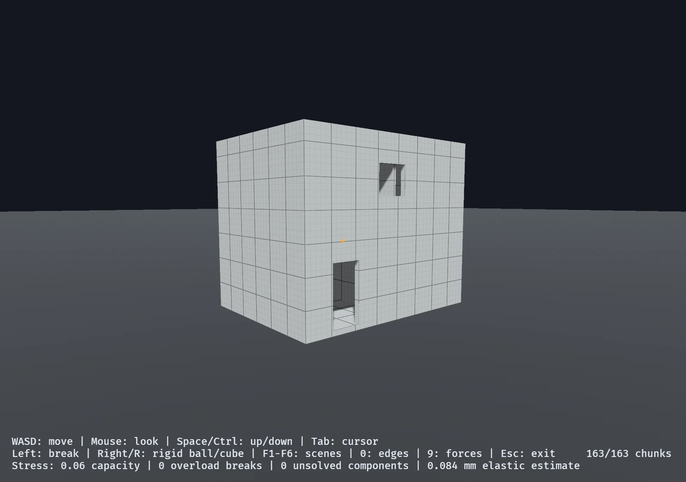
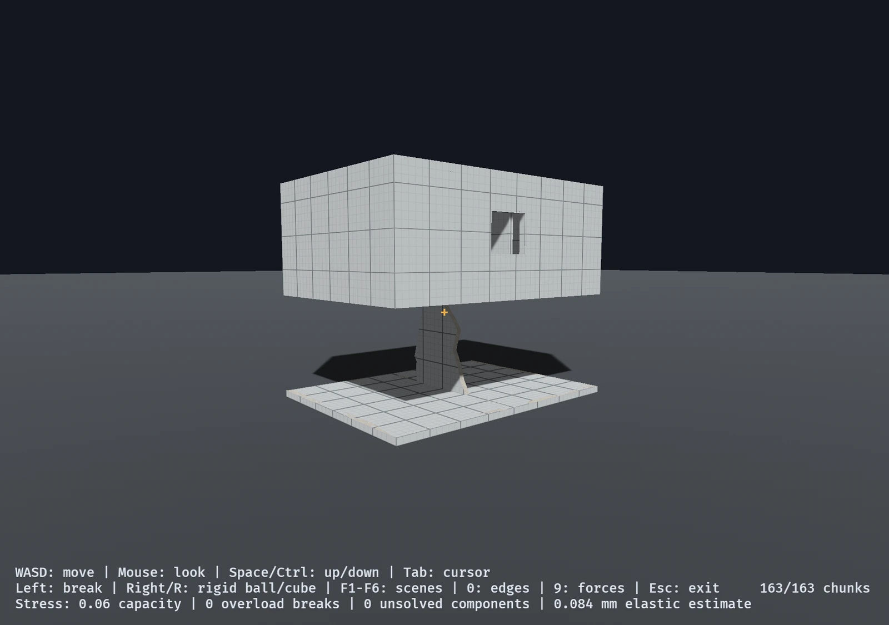
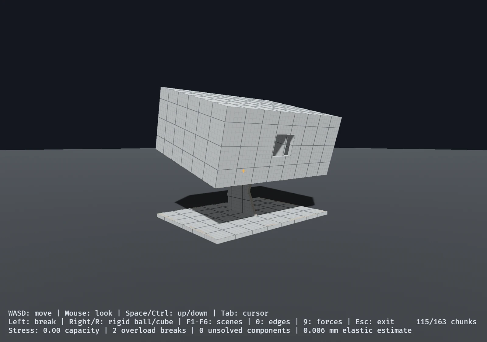

# ADR 0002：六自由度结构承载与过载断裂

## 状态

已采用并实现。六自由度小变形模型于 2026-11-16 提出，准静态自重、过载断裂和受损图的稳健求解于 2026-11-17 实现。本记录于 2026-11-19 合并这些决策。

## 背景

连通图可以判断建筑是否还连着地基。仍连着的悬臂或窄支撑也可能因载荷集中、弯曲和剪切而失效。连接承载需要使用真实接触截面，在整个连通分量上求解闭环、多支点与断裂后的载荷重分配。

## 决策

### 模型与边界条件

每个 Chunk 的未知量为质心处的三维平移 $u$ 和小转角 $\theta$。固定 Anchor 锁定全部六个自由度。锚定分量以建筑坐标系中的真实自重 $mg$ 和外部质心力、力矩组装平衡方程 $Kq = f$，其中 $q$ 汇集所有待求平移和转动自由度。脱离地基的动态簇用 [ADR 0003](0003-collision-driven-fracture.md) 定义的接触载荷工况。求解位移用于恢复连接内力，显示及碰撞使用 [ADR 0001](0001-rigid-cluster-runtime.md) 的刚体簇。

设面片中心为 $p$，父连接中心为 $p_{\mathrm{bond}}$，端点质心为 $c_a, c_b$。共同界面点上的位移跳跃 $d$ 与相对转角 $\phi$ 为：

$$
\begin{aligned}
d &= \left(u_b + \theta_b \times (p-c_b)\right) - \left(u_a + \theta_a \times (p-c_a)\right) \\
\phi &= \theta_b - \theta_a
\end{aligned}
$$

每个面片使用自身面积 $A$、单位法线 $n$、未归一化面积二阶矩 $Q$（$\mathrm{m}^4$）和力臂。令 $P = \mathbf{1} - nn^{\mathsf{T}}$、$Q_p = PQP$，$C$ 为 $n \times$ 的反对称矩阵，$B = C Q_p C^{\mathsf{T}}$。各面片共用父连接等效长度 $L$：

$$
\begin{aligned}
L &= \lVert p_{\mathrm{bond}} - c_a \rVert + \lVert p_{\mathrm{bond}} - c_b \rVert \\
G_i &= \frac{E_i}{2(1+\nu_i)} \\
E &= \operatorname{harmonic\_mean}(E_a,E_b), \quad G = \operatorname{harmonic\_mean}(G_a,G_b) \\
K_{\mathrm{translation}} &= \frac{A}{L}\left(Enn^{\mathsf{T}} + GP\right) \\
K_{\mathrm{rotation}} &= \frac{EB + G\operatorname{tr}(Q_p)nn^{\mathsf{T}}}{L} \\
\mathrm{energy} &= \frac{d^{\mathsf{T}} K_{\mathrm{translation}} d + \phi^{\mathsf{T}} K_{\mathrm{rotation}} \phi}{2}
\end{aligned}
$$

由面片轴力和完整截面弯曲分布恢复法向应力，由直接剪切和极惯性扭转近似恢复切应力。在真实凸面片顶点取应力极值。拉、压、剪分别使用两端材料中较低的对应强度，三个应力比的最大值为面片承载率，父 Bond 取其面片的最大承载率 $U$，力矩按父连接中心汇总。面片的有效性、面积和坐标由 [ADR 0005](0005-v2-asset-contract.md) 定义。

### 求解与失败处理

- 以 f64 组装确定性的 6×6 分块稀疏系统，按特征长度缩放旋转自由度。使用分块 Jacobi 预条件的共轭梯度法，替换递推残差时重启搜索方向。
- 超过 512 次普通迭代，或装配系统的候选解未通过原始界面残差时，用确定性最小度排序的稀疏 Cholesky 因子修正。困难路径以高、低两部分保存位移，以补偿乘加恢复界面形变、内力和残差。默认相对残差为 $10^{-8}$，迭代及修正共用 3000 次预算，最终检查原始单元上的自由节点力、力矩平衡。
- 无支撑路径、退化截面、非正定或未达残差目标均报告失败。无效分量暂停基于承载的断裂，有效分量、点击伤害和已确定的拓扑仍可更新。失败每模拟秒重试，拓扑和配置变更会触发重算。全部分量无有效结果时 HUD 显示 `unavailable (retrying)`。有效结果复用的条件见 [ADR 0010](0010-runtime-performance.md)。

### 过载与释放

默认在 60 Hz 固定步计算承载。每步对有效应力结果积分一次：

$$
\begin{aligned}
\mathrm{damage} &\leftarrow \mathrm{damage} + \frac{\Delta t \max(U-1,0)}{0.5\,\mathrm{s}} \\
\mathrm{eligible} &= (\mathrm{damage} \geq 1) \lor (U \geq 4)
\end{aligned}
$$

每栋建筑每固定步最多断开 4 条连接，按 $U$ 降序及稳定 Bond ID 排列。预算外的损伤保留，断裂改变的载荷在下一个固定步求解。断键只改变连接，失去最后一个 Anchor 的连通分量才在物理准备前释放。有效固定支撑可以传递弯矩，真实接触与重力决定释放后的下落和倾斜。

## 备选方案与取舍

沿树或最短路径累计重量难以表示闭环与刚度不同的多支点。整体平衡可预测远离损伤点的载荷变化。稠密直接解用于小图参考，困难路径以额外因子开销换取窄支撑精度。支撑投影规则适用于不同的支承假设，单靠重心越过投影无法判断可传递弯矩的固定支撑是否失效。

## 验证要求与结果

- 检查解析悬臂、真实截面应力、多支点载荷分担、闭环稠密参考、刚体运动零应变，以及支柱移除后的全分量重分配、持续过载和无效解诊断。六个正式 v2 场景的完整自重平衡验证通过。
- 固定 [v2 窄支撑夹具](../../src/stress/fixtures/README.md)通过原问题的受损图回归。它保留独立的 255 块、845 条连接图，以隔离正式分块变更。验收核对自由节点残差、总力矩平衡、真实下落和残桩接触。
- `--stress-smoke-test` 使用所选正式场景和独立 SI 双柱梁分别验证完整自重、单支柱移除后的仍连通超载、断键、下落与休眠。`--collapse-smoke-test` 从矩形楼当前几何和连接图选取偏侧支撑。提交 `223660d` 记录的正式 v2 矩形验证通过，上部成组下落并倾转，记录了实际静态残桩接触冲量。

### 矩形楼失支撑过程

| 完整楼体 | 保留偏侧窄支撑 | 上部成组倾倒 |
| --- | --- | --- |
|  |  |  |

三张图来自正式矩形楼的 `--collapse-smoke-test`。移除大部分首层支撑后，上部在重力和真实接触下成组倾转，报告记录了与静态残桩的接触冲量。

## 未决问题

模型适用小变形、各向同性连接。屈曲、塑性铰、可见挠曲、配筋和完整瞬态应力波需独立模型。长期疲劳、断裂能与材料玩法标定仍待验证。

## 来源

[应力求解](../../src/stress/mod.rs)、[解析和数值回归](../../src/stress/tests.rs)、[承载运行时](../../src/stress_runtime/mod.rs)和 [Itasca Linear Parallel Bond Model](https://docs.itascacg.com/itasca950/common/contactmodel/linearpbond/doc/manual/cmlinearpbond.html)。
