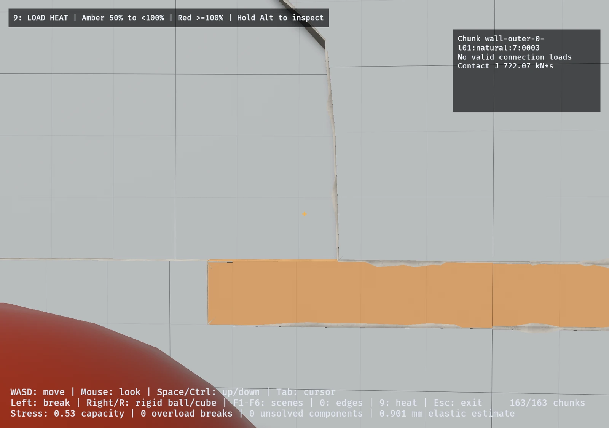

# ADR 0003：碰撞驱动的断裂与事件卸载

## 状态

接触冲量断裂、动态簇惯性平衡、逐连接卸载及独立事件首次绑定均于 2026-11-17 采用并实现。本记录于 2026-11-19 合并这些决策。**独立新事件的绑定回归通过，正式板式高楼的严格落地破坏回归仍失败。**

## 背景

碰撞由 Avian 对真实刚体施加冲量。结构层需要同时处理命中块附近的直接载荷，以及整个多块动态簇减速时跨连接传播的力和力矩。裂缝改变传力路径，已经分析的冲量工况必须在分离时卸载。

## 决策

### 接触资格与局部断裂

- 在物理求解后读取接触对的法向冲量，单位 N·s。求解前最大法向接近速度至少为 `2 m/s`、合冲量非零且至少涉及一个存活结构 Chunk 时，接触可触发断裂。只有消费有效结构冲量后才标记接触对，持续接触保留标记到接触结束。
- 静态簇、单块和动态全簇求解失败时走局部路径。将局部坐标的冲量按直接命中 Chunk 的相邻有效面片面积分配，以 `0.01 s` 标定时间换算面片受力。使用各片法线分解拉、压、剪，以两端材料较低强度算承载率。以面片最高承载率提名父 Bond，门槛为 $U \ge 1$。局部候选按承载率降序及稳定键排列，共用全局每固定步 8 条撞击断键预算，超预算的有效候选留待后续步。
- 球和方块是保持完整的有限质量刚体，碰撞、反弹、速度与重力均由 Avian 处理。两者初速 `55 m/s`、质量 `8000 kg`，球半径 `0.65 m`、方块边长 `1.2 m`，摩擦为 `0.4`、恢复系数为 `0.1`，启用扫掠式 CCD。同时最多 12 个，达到上限时跳过新发射。存活超过 `20 s` 或落到 $Y < -20\,\mathrm{m}$ 时回收。发射控制见 [ADR 0006](0006-demo-scenes-and-controls.md)。

### 动态簇的惯性平衡

同一固定步内，按多块动态刚体聚合新接触的逐点冲量及其相对 Avian 碎块质心的冲量矩。惯性平衡使用建筑资产坐标系和 f64。设第 $i$ 块 Avian 质量为 $m_i$，质心相对簇质心的位移为 $r_i$，质心惯性转到簇坐标后为 $I_i$，本次实际接触给它的冲量和质心冲量矩分别为 $J_i$ 和 $L_i$。以这些碎块属性组装簇质量 $M$ 和惯性 $I$，见 [ADR 0012](0012-density-derived-mass-properties.md)：

$$
\begin{aligned}
J &= \sum_i J_i \\
L &= \sum_i \left(L_i + r_i \times J_i\right) \\
\Delta v &= \frac{J}{M} \\
\Delta \omega &= I^{-1}L \\
F_i &= \frac{J_i - m_i\left(\Delta v + \Delta \omega \times r_i\right)}{\tau} \\
T_i &= \frac{L_i - I_i\Delta \omega}{\tau} \\
\tau &= 0.01\,\mathrm{s}
\end{aligned}
$$

$\tau$ 是游戏载荷标定时间。扣除整体加速后，力及相对簇质心的力矩分别满足 $\sum_i F_i = 0$ 和 $\sum_i \left(r_i \times F_i + T_i\right) = 0$。提交弹性网络前将 $T_i$ 换算到 [ADR 0002](0002-elastic-structure-and-overload.md) 的结构节点，力及力矩平衡的相对误差门槛均为 `1e-6`。动态工况的载荷来自接触，并仅在数值系统固定一个节点的六个自由度，规范点反力和反力矩相对接触载荷尺度应不超过 `1e-5`。真实 Anchor 状态和刚体动量由物理层维护，结构求解只影响连接损伤。

### 断裂与卸载

- 每固定步最多运行一次动态结构求解，单次结果最多选择当前承载率最高且 $U \ge 1$ 的一个 Bond，同值按 Bond ID 升序选取。提交该条断裂后，若原成员仍属同一簇，则下一次使用当前连接图重算。成员分居多个簇时卸载已准备事件，成员死亡时作废。
- 独立事件尚未准备惯性工况时，按原始逐块冲量的受载来源定位当前簇。全部受载 Chunk 必须存活，并同属一栋建筑、同一个未锚定的动态簇。若当前成员都是原簇成员，可以在该子簇以原冲量首次建立工况。来源跨簇时结束事件，来源或成员失效时作废。少于两块时无需进行内部求解。准备完成后使用已求解事件的卸载规则。
- 结构求解读取的冲量仅用于应力估计。Avian 将碰撞冲量施加一次，拆分按 [ADR 0001](0001-rigid-cluster-runtime.md) 继承当前速度场。后续子簇损伤由新的真实碰撞驱动。`rebound_fresh_structural_events` 单独标识首次绑定到变化后的簇，区别于已准备事件的卸载。

## 备选方案与取舍

单次求解后保留完整断裂名单会继续沿失效的载荷路径切断连接，将父事件完整冲量重新分配给更小的子簇也会改变工况惯性尺度。逐处重算需要额外求解，换取表达分离卸载。全面取消成员变化的事件会漏掉尚未处理的独立接触，按真实受载源首次绑定可以保留这一工况。曾尝试在另一个接触导致分离后重新平衡已求解事件，旧资产试验仍只剥落接触层，方案未采用。

## 验证要求与结果

- 球、方块的真实接触断键、反作用速度、撞击物质量与形状保留，以及低于门槛接触和后续静止接触的回归通过。多块动态测试覆盖总力和总力矩平衡、规范点选择不改变连接内力、纯刚体速度变化产生零内部载荷、面片细分一致性和图形采样开关不改变断裂选择。
- 三块自由梁先被其他断裂分为 `2+1` 后，仍在两块子簇上的独立新事件只绑定一次。承载率、载荷平衡及所选断键与直接求解该子簇一致，刚体速度保持原值。已求解的父事件在分离后卸载，尚未求解且受载来源分居两侧的事件结束。以上独立事件回归通过。
- **严格落地仍失败。** `projectiles::tests::dropped_upper_tower_fractures_on_ground_contact` 默认使用正式 [highrise_slab 清单](../../assets/buildings/highrise_slab.destruction.json)。失败记录的资产 ID 为 `4e05bcd6cd187cacf83a7f6683e29d08449233bc9e1f915061a47bbebebafbed`。提交 `d462e4d` 的验证中，上部经历 18 次结构求解及 18 个断键，最终仍为 `[1,1,116]`。严格回归要求分离含楼板和墙体的多块楼层部分，并检查接触层以上的内部断键。
- `--landing-smoke-test` 从正式高楼去除下半部，验证零初速自由落体、真实接地、内部断裂、成组保留、质量及载荷平衡。设置 `DESTRUCTION_LANDING_TRACE=1` 可从严格回归记录求解前速度、断键、面片和事件状态。
- 切换到 [ADR 0012](0012-density-derived-mass-properties.md) 的质量属性后，严格回归仍得到 18 次求解、18 条断键及 `[1,1,116]`。使用同一 `highrise_slab` 的游戏内落地烟测前后都在第 253 帧触发撞击，最终为 `[105,1,1,1,1,1]`，上部内部断键从 8 条增至 9 条。

### 实际接触冲量

正式矩形楼的刚球撞击验收帧。右上角显示所选碎块的真实法向接触冲量，约为 722 kN·s。该碎块此时暂无有效连接内力。

## 未决问题

高楼落地轨迹显示整簇的接触响应先完成，结构断裂随后逐步处理。主簇首次分离时已经向上运动，断键集中在接触层。改善耦合需要同时验证动量、载荷平衡、真实卸载与远离接触层的破坏。静态簇释放后的冲量重分配、完整应力波、应变率和裂纹耗能仍待研究。接触对合冲量为零的纯力偶可能被当前资格门槛跳过。

## 来源

[撞击处理](../../src/projectiles/mod.rs)、[碰撞与落地回归](../../src/projectiles/tests.rs)、Avian 0.8.0 的窄相位 `normal_speed` 与求解后法向冲量，以及 [NVIDIA Blast Stress Solver](https://nvidia-omniverse.github.io/PhysX/blast/docs/api/extensions/ext_stress.html) 的载荷传播参考。
