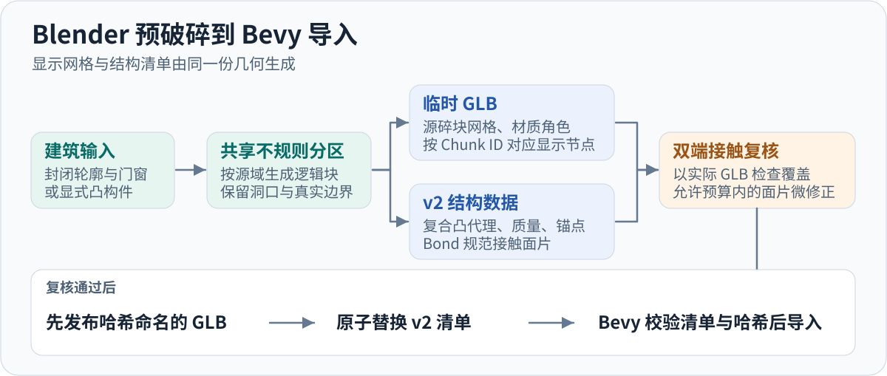

# ADR 0004：Blender 制作与自然不规则预破碎

## 状态

已采用并实现。2026-11-16 选用 Blender，2026-11-17 发布六个正式 v2 场景。

## 背景

建筑需要共享的天然形态断裂边界，同时保留外轮廓、门窗、质量及承载关系。破碎在离线阶段完成，运行时由玩家行为和真实接触决定何时断开连接。

## 决策与实现

源网格和结构数据在发布前依据实际 GLB 一起复核。运行时从清单读取并校验同目录的 GLB。

- 使用 Blender 原生 Python/BMesh，提供面板、后台命令和目录构建。标准输入包括闭合平面外轮廓、楼层和墙板厚度、可选庭院及内墙、门窗标记、物理材料、目标碎块尺度和种子。先生成不重叠的封闭源构件，再进入预破碎。
- 桥梁等结构可用 `parts` 直接提供显式凸棱柱。每项使用唯一 ID、构件类别、有效材质、位于 `footprint` 内的凸轮廓及有效底、顶标高。允许构件共面接触，拒绝体积重叠。此模式替代围墙和楼板自动生成，排除庭院、内墙和门窗参数。
- 水平和竖直凸棱柱按墙、楼层或框的语义及材料组成共享源域，合并相容的厚度轮廓，并保留棱柱的线性厚度变化。门窗和庭院在固定源域中留空。人工面板边界可以跨越，两个相邻形状共享同一次分区产生的切边。
- `fracture_size` 为目标逻辑块尺度 $s$，微单元采样间距为 $0.28s$。每个站点从域包围盒内抽取 512 个候选，在源域内选择离现有站点最远的点。设 $D$ 为域包围盒对角线长度，$N$ 为站点数。第三个站点起检查最小间距 $\min\left(0.6s,\frac{0.75D}{\sqrt{N}}\right)$。分区场使用独立旋转的非周期三层梯度噪声，波长和幅值相对目标尺度分别为 $(2.5, 0.32)$、$(1.0, 0.12)$、$(0.45, 0.04)$。
- 连通逻辑块的投影面积限定为平均站点面积的 0.2 至 3 倍，投影包围盒对角线不超过目标尺度的 3 倍。设 $w$ 为源域继承宽度，长宽比不超过 $\max\left(6,\frac{2s}{w}\right)$。微小连通片只沿真实有限公共面转交相容邻区。重建时消除共面内面、补齐 T 型接点，合并凸子体时同时检查原顶点、支撑平面和体积，保留凹口、正体积材料、质心与完整惯性。
- 每源域最多 256 个站点、12,000 个微单元、12 次确定性尝试，每块最多 48 个凸代理，每个资产最多 2,048 块。尝试种子由输入种子、域 ID 和尝试编号推导。失败报告原因并保留前一次成功结果，不降级到其他分块算法。
- 重生成仅替换工具拥有的建筑内容，保留用户物体和子集合。相同制作输入、种子和工具版本生成相同的结构身份和拓扑。导出、连接精度与坐标契约见 [ADR 0005](0005-v2-asset-contract.md)。

## 正式资产

六个清单是运行时的发布入口。计数依次为逻辑块、凸代理、父连接和承载面片。

| 场景 | 逻辑块 / 代理 / 连接 / 面片 | 资产 ID |
| --- | --- | --- |
| [矩形](../../assets/buildings/rectangle.destruction.json) | 163 / 2143 / 524 / 3661 | `28d80db4a70baff023c26c907b2aab492e93c830225a101b2ec60bb7e5b68fee` |
| [L 形](../../assets/buildings/l_shape.destruction.json) | 269 / 3180 / 894 / 6332 | `b6bde21c7ddaa5a0f78110782ab667b92dba20d3e13babd3799f8f24343d471e` |
| [庭院](../../assets/buildings/courtyard.destruction.json) | 283 / 3700 / 941 / 6730 | `4555e4605eea1a0ad47d1e13c5bdad293cad4a195cabdedc29a725e08804ded9` |
| [板式高楼](../../assets/buildings/highrise_slab.destruction.json) | 228 / 2577 / 734 / 4308 | `4e05bcd6cd187cacf83a7f6683e29d08449233bc9e1f915061a47bbebebafbed` |
| [L 形高楼](../../assets/buildings/highrise_l.destruction.json) | 227 / 2190 / 749 / 4529 | `c0b1b43ade54c27b65d5a0633cc8e25cb1eeed159ab0cb7f8f24e2d8d2f73fbb` |
| [桥梁](../../assets/buildings/bridge.destruction.json) | 71 / 362 / 164 / 964 | `3cc25d7a6f7aa5b518bf5e4ab4e20c30d3380ea01dddb268aa91107360bc8952` |

## 备选方案与取舍

规则凸 Voronoi 能降低代理数量，但只能生成平面切边。仅扰动显示网格会让物理、拾取及承载面与断裂外观不一致，整块取单一凸包又可能封住洞口。共享分区和精确复合凸代理保留一致的几何边界，代价是更高的制作和运行时碰撞成本。Python/BMesh 路径便于批处理、数据验证和事务发布，交互预览由制作面板提供。

## 验证与未决问题

- 六个正式场景通过清单、实际 GLB 哈希和材质角色、双端真实接触覆盖及初始自重平衡检查，实测每块至多使用 28 个凸代理。制作回归检查封闭性、凸性、体积和惯性守恒、开口净空、真实锚定路径、可重复导出和事务回滚。
- 正式目录发布时，Blender 5.2.3 后台套件 63 项通过，独立脚本目录中的插件安装、注册和停用通过。正式矩形点击和偏侧支撑倾倒有引擎图形验证。高楼落地破坏程度的已知限制见 [ADR 0003](0003-collision-driven-fracture.md)。
- 复杂构件上的局部最小宽度、跨源构件的自然切边、凸代理预算及复杂几何输入仍需验证。性能测量见 [ADR 0010](0010-runtime-performance.md)。

## 来源

[制作工具说明](../../tools/blender/README.md)、[目录生成入口](../../tools/blender/build_catalog.py)、[桥梁显式构件示例](../../tools/blender/examples/bridge.json)、[自然分区实现](../../tools/blender/bevy_destruction/natural.py)、[凸合并实现](../../tools/blender/bevy_destruction/natural_union.py)。
