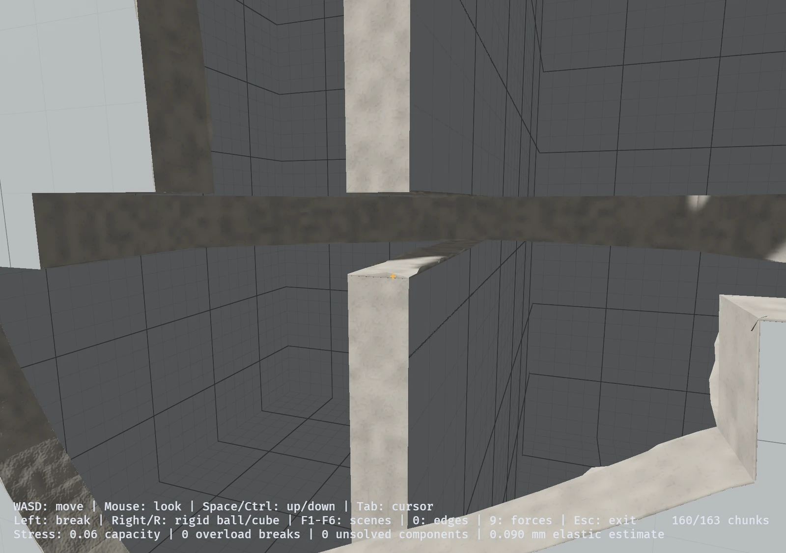

# ADR 0007：源网格、随物体移动的材质与断面着色

## 状态与日期

已采用并实现。2026-11-17 采用静止建筑坐标和源网格保留规则，2026-11-18 采用同一源三角形内的断面着色。

## 背景

基于世界位置的程序化材质会在碎块移动时滑动，逐块独立的局部坐标会使相邻碎块的图案失去连续性。薄壁和微小接触区域若在离线阶段重新切分显示网格，容易改变源几何。早期的独立共面显示层则会在近景和掠视处与源三角形争用深度，出现网格材质闪烁。

## 决策与实现

- GLB 保留源碎块的顶点、面和拓扑。制作端只把被真实接触完全覆盖的源面整体标为 `fracture`。部分覆盖的源面保留外表面角色，运行时使用 [v2 规范接触面片](0005-v2-asset-contract.md) 区分实际覆盖区域。制作端核对实际 GLB 的两端覆盖。
- 材质采样采用不可变的米制建筑初始坐标。`UV0.xy` 与 `UV1.x` 保存三维位置，显示位姿随刚体变化，相邻碎块的图案相位在初始姿态保持连续。可选边带使用同一坐标约定。片元阶段用导数恢复原表面方向，将断面微法线映射到当前姿态。
- 外表面把初始坐标投影到正交面内基，默认细格与粗格间距分别为 0.2 m、1.0 m，目标线宽分别为 0.8 px、1.8 px。屏幕导数用于抗锯齿和远处淡出。
- 在源三角形的同一次片元着色中，于规范接触区域使用对应材料的断面颜色、微法线、粗糙度和金属度，其余区域使用 grid。保留正常的深度测试、深度写入、阴影、预通道和源材质剔除设置。屏幕导数在材质分支之前求值。
- 按实际有限重叠筛选每个三角形的候选多边形，候选平面容差为 40 µm。片元以相对多边形原点的坐标执行凸半空间判定，边判定余量为 0.5 µm。多边形和候选集合去重后使用按资产缓存的共享只读 GPU 缓冲。
- `UV1.y` 存放每个三角形一致的候选列表索引，索引小于 $2^{20}$，保持 `Float32x2` 并由 GPU 四舍五入读取。仅在需要时展开索引顶点，保留源位置、法线、三角形和用于拾取的几何。派生网格按源网格及初始变换缓存，源卸载时释放闲置派生资源。

## 备选方案与取舍

- 每帧为碎块上传材质逆变换会增加实例资源及更新成本。复用 Bevy 标准顶点通道可共享材质和缓存，代价是需要派生显示网格，并占用两个 UV 通道。
- 加大深度偏置或沿法线挪动显示层会改变遮挡和薄壁接缝的表现。离线细分接触区域曾在微小交点处丢失源角点。单次片元着色保留源几何，代价是局部候选读取和区域判断。

## 验证

- 验证要求覆盖坐标连续性、源网格与各属性保留、缓存回收、有限接触与洞口、材质随刚体平移旋转，以及近远视角、掠视、遮挡和深度预通道。
- 正式 v2 发布通过六场景的接触覆盖及材质角色检查。`8761ca9` 的 8 组真实 GPU 对照共 40 张图，复现旧显示层的 grid 泄漏，验证修复后的接触区域与正确断面参考一致，外部 grid 和前方遮挡正确。`--material-smoke-test` 的世界锁定负对照和材质运动检查也已完成。

### 破口近景

正式矩形楼局部破坏后的引擎截图。浅色区域是暴露接触面的粗糙断面，周围灰色表面仍保留网格。该次验收关闭了 VFX，便于观察材质交界。

## 未决问题

非均匀缩放、带作者 UV 贴图的外部模型与其他渲染后端仍需验证。片元成本受屏幕覆盖和候选数影响，静态缓冲大小只描述资源规模。

## 来源

- [材质实现](../../src/material/mod.rs)、[接触遮罩](../../src/contact_mask/mod.rs)、[表面着色器](../../assets/shaders/building_surface.wesl)及锁定 Bevy 的标准顶点、深度预通道和缓冲接口。
- 坐标、源网格接触覆盖及单次着色分别见提交 `1f17b8d`、`525be3e`、`8761ca9`。
