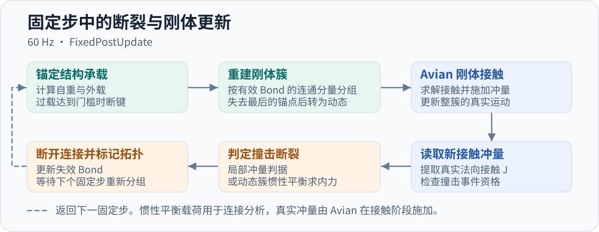

# ADR 0001：预破碎结构与刚体簇运行时

## 状态

已采用并实现。预破碎结构和 Avian 技术栈于 2026-11-16 确定，失支撑释放于 2026-11-17 实现，细长凸代理构造于 2026-11-18 修订。本记录于 2026-11-19 合并这些决策。

## 背景

局部断裂应改变支撑和刚体组合，使残骸在重力下离开建筑，并可能造成二次破坏。预破碎决定可用的断裂边界，运行时决定断裂时刻、顺序和运动。完整建筑阶段若每个碎块都独立参与接触求解，成本随碎块数量增加。

## 决策

### 资产、实例与支撑

- 几何层负责源网格、材质与装饰效果。结构层负责 Chunk、Bond、Anchor、载荷与运行时拓扑。物理层负责刚体簇的碰撞、质量、位姿、速度和接触。
- Chunk 是结构及质量的基本单位，关联显示 primitive 和一个或多个凸代理。Bond 是一对 Chunk 的结构和断裂身份，保存 [ADR 0005](0005-v2-asset-contract.md) 定义的真实接触面片。Anchor 表示与世界的永久固定边界。
- 共享资产提供稳定 Chunk/Bond ID、内容标识、几何和烘焙质量。每个建筑实例独立维护碎块存活、连接有效性、拓扑脏状态和簇归属。实例与资产内稳定 ID 共同确定身份，ECS 实体编号可随重建变化。
- 按稳定 ID 遍历存活 Chunk 与有效刚性 Bond。每个连通分量对应一个刚体。存在有效固定 Anchor 的簇为静态，失去最后一个 Anchor 后转为动态。接触和休眠期间保持原 Anchor 状态。成员和锚定状态未改变的簇复用原刚体。
- 支撑连通性决定刚体类型，连接承载由 [ADR 0002](0002-elastic-structure-and-overload.md) 求解。动态接触如何驱动断裂见 [ADR 0003](0003-collision-driven-fracture.md)。可见建筑随刚体簇运动。

### 固定步和碰撞

图中的回路从撞击断键返回下一固定步。子簇在下一次重建时继承当前刚体运动。

- 使用 Bevy 0.20 和 Avian 0.8，物理步长固定为 60 Hz。在 `FixedPostUpdate` 中，准静态承载先于刚体簇重建，重建早于 `PhysicsSystems::First`，撞击采样在 `PhysicsSystems::Last` 之后。
- 每个 Chunk 保留带有 `ChunkIdentity` 的子 Collider，复合形状由资产凸代理组成。换属前禁用受影响的 Collider 并刷新操作，以清除 Avian 的旧接触。更新 `ColliderOf` 并刷新关系后，移除弃用的刚体，再启用存活 Collider。这样接触和约束缓存不会引用已移除的刚体。
- 每个代理先按原坐标构造凸包。若 Parry 将细长点集误判为低维并使构造失败，在包围盒各轴分别归一化后确定凸包面，检查三维点面数及正有向体积，再用原始坐标和这些面构造多面体。成功时保持原代理位置、尺度和复合形状归属。两种方法均失败时拒绝加载，并报告碎块 ID 和代理序号。
- 固定地面是顶面 $Y=0$ 的 `400 m × 0.2 m × 400 m` 盒体，重力沿世界负 Y。地面和建筑簇的摩擦为 `0.7`，恢复系数为 `0.0`。

### 质量与运动继承

簇沿用来源建筑坐标系的原点和方向。Avian 按各 Chunk 的材料密度与复合碰撞体计算质量、质心及惯性，并汇总同簇成员，见 [ADR 0012](0012-density-derived-mass-properties.md)。新簇完成换属后立即计算质量属性，拆簇读取父簇真实物理位姿、速度及 Avian 质心。子簇继承原世界位姿，动态显示再对物理变换插值。设 $c_{\mathrm{child,world}}$ 和 $c_{\mathrm{parent,world}}$ 为世界质心：

$$
\begin{aligned}
v_{\mathrm{child}} &= v_{\mathrm{parent}} + \omega_{\mathrm{parent}} \times \left(c_{\mathrm{child,world}} - c_{\mathrm{parent,world}}\right) \\
\omega_{\mathrm{child}} &= \omega_{\mathrm{parent}}
\end{aligned}
$$

静态簇首次释放时速度为零。删块会移除质量，完整动量守恒比较适用于成员质量总和保持的自由拆分。

## 备选方案与取舍

全楼单刚体难以局部分离，逐块独立刚体和固定关节会提前增加接触与约束成本。Avian 的 ECS 接口允许复用刚体并保留 Chunk 级碰撞身份。对非凸碎块整体取凸包或简化细长子体会损失真实轮廓和净空。分轴构造增加失败时的计算，保留已烘焙的代理几何。

## 验证要求与结果

- 检查图遍历确定性、实例隔离、锚点释放、相邻刚体接触的换属清理，以及旋转簇拆分前后的世界位姿和动量。提交 `c56f2b5` 的首次回归通过，三个当时的场景确认成组下落、空中再次拆分、承接和休眠。
- `--physics-smoke-test` 在重建后、物理求解前检查拆簇连续性，再检查实际接触与休眠。世界质心距离容差为 `1e-4 m`，四元数逐分量容差为 `1e-5`，线速度和角速度向量距离容差为 `1e-4`。独立运行时测试覆盖永久地面，实际建筑的烟测允许楼板承接。目录迁移后的验证见 [ADR 0011](0011-rust-project-layout.md)。
- 提交 `dfd8205` 的凸代理构造回归通过六个正式场景，检查各代理保留在复合形状内，原失败代理的八个顶点保持不变。L 形楼的实际加载和首次点击通过。

## 未决问题

仍需评估较大场景的碰撞体与接触预算、远离建筑原点的数值精度、移动支撑和可相对运动的弱连接。细长代理的后备路径仅在直接构造失败时启用，可进一步评估已接受凸包的几何精度。大型残骸落地的断裂耦合另见 [ADR 0003](0003-collision-driven-fracture.md)。

## 来源

[结构图](../../../src/structure/mod.rs)、[物理接入](../../../src/physics/mod.rs)、[场景与凸代理构造](../../../src/scene/mod.rs)、[Avian 0.8.0 调度](https://docs.rs/avian3d/0.8.0/avian3d/schedule/enum.PhysicsSystems.html)及[锁定依赖](../../../Cargo.lock)。
