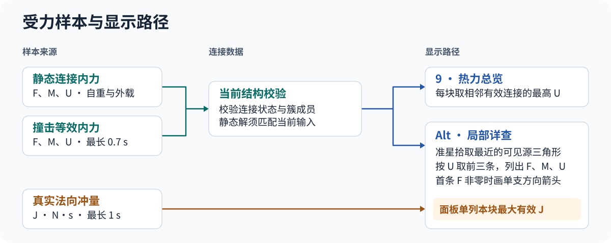
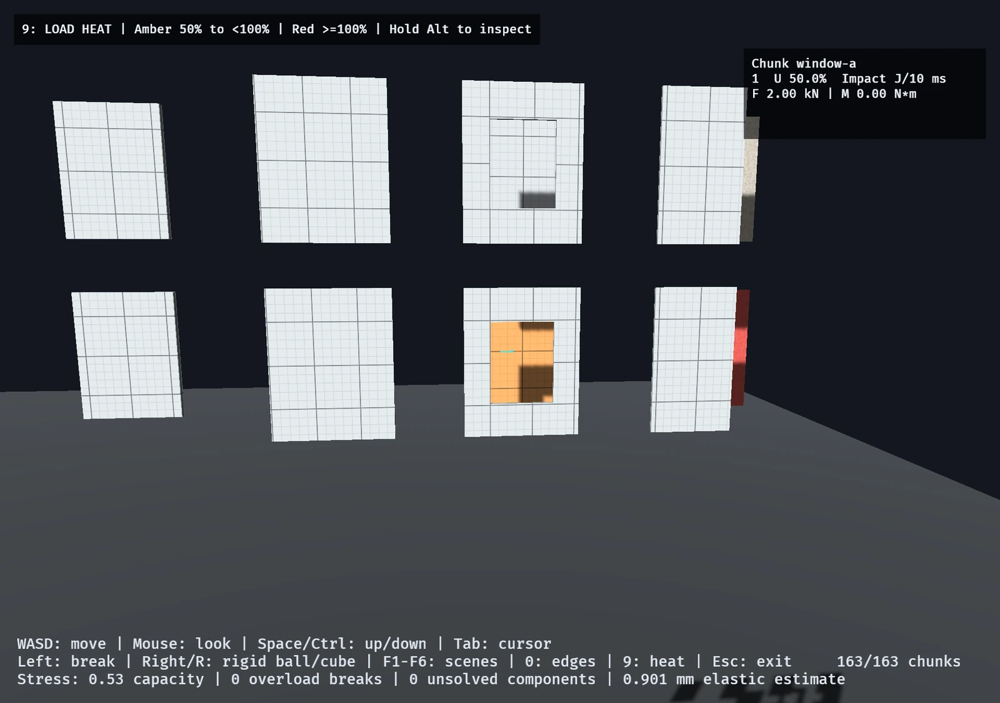

# ADR 0009：受力样本、热力总览与局部详查

## 状态与日期

2026-11-17 采用并实现内力和接触冲量采样。2026-11-18 采用分级热力总览和准星局部详查，替代早期全场线框。

2026-11-24 详查拾取改用 Avian 的 `ColliderAabb`。

2026-11-24 将拾取网格的精确顶点合并交给 Avian。

## 背景

视图需要呈现自重、撞击和断键之间的关系。全场线框即使限制在可见碎块内，连接、质心和箭头仍会在复杂结构中相互叠加。开关采样时应得到相同的物理求解和断裂结果。

## 决策与实现

### 样本与有效期

| 数据 | 来源与单位 | 生效条件 |
| --- | --- | --- |
| 静态 $F$、$M$ | `StressState` 中的当前 `BondStress`，单位 N、N·m，反映自重与当前外载 | 实例、外载、设置版本和局部重力与求解缓存一致，连接有效且两端存活并属于同一静态刚体 |
| 撞击等效 $F$、$M$ | 通过数值约束反力检查的惯性平衡求解，单位 N、N·m，标签为 `Impact J/10 ms` | 最长 0.7 个模拟秒，未锚定动态刚体、成员集合及连接状态签名仍匹配 |
| 接触冲量 $J$ | Avian 流形接触点的正 `normal_impulse`，按法线和碰撞侧符号构造，单位 N·s | 最长 1 个模拟秒，受载碎块仍存活，面板显示本块有效样本的最大幅值 |
| 承载率 $U$ | `BondStress.utilization`，按应力与材料强度求得的无量纲数值 | 与对应内力使用同一有效性判定 |

读取 v2 父连接的合力、关于父连接中心的合力矩和各面片最高承载率。`ForceSamples` 最多保留 8 个刚体各自的最新求解帧及 128 个独立接触点冲量。成员死亡、簇分离或实例中任何连接状态变化均使旧内力帧失效。接触冲量按自身有效期保留。结构求解和撞击断裂规则分别见 [ADR 0002](0002-elastic-structure-and-overload.md) 与 [ADR 0003](0003-collision-driven-fracture.md)。

### 总览、拾取与详查

- 按 `9` 或小键盘 `9` 切换，默认关闭。每块使用有效相邻连接的最高 $U$。无有效结果或 $U$ 小于 50% 时保留原色，50% 至低于 100% 为琥珀色，100% 及以上为红色。
- 每个网格实例以 `MeshTag` 表达颜色档位。只在档位变化时更新，按 [ADR 0007](0007-fracture-surface-rendering.md) 的源材质着色混色，保留正常深度遮挡、预通道和实例隔离。关闭后清空样本与热力标记。
- 热力图开启且窗口聚焦、相机捕获输入时，按住 `Alt` 以准星射线选择最近的源三角形。射线从近裁剪面出发，按渲染姿态查询，穿过真实洞口并受不透明的建筑、地面及刚性撞击物遮挡。不同碎块在同一深度命中时取消选择。按资产和碎块缓存源三角形 BVH，资产修改或移除时失效。
- 面板按 $U$ 降序显示最多三条有效连接，同 $U$ 按连接 ID 排序，列出 $F$、$M$、$U$ 及静态或撞击工况。首条连接有非零 $F$ 时只画选中端的一支力方向箭头，方向由合力及端点确定。设 $d$ 为准星射线距离，箭头长度为 $\min(0.35\,\mathrm{m}, 0.12d)$。真实 $J$ 单列。无有效连接内力时显示不可用，松键、失焦或失去命中时清除选择。

## 备选方案与取舍

限制全场箭头数量会增加随视角和排名变化的标记跳变。分级着色突出负载区域，具体方向和数值由局部详查提供。每实例标签复用现有材质与深度路径，额外成本集中于采样、数据遍历和详查时的射线查询。

源网格和遮挡 Collider 共用 `ColliderAabb`。源网格从 `ColliderAabb::INVALID` 逐点收紧到实际边界，遮挡物直接使用 Avian 返回的包围盒。局部射线仍按原有近平行容差裁剪，以维持沿边界观察时的选取行为。

拾取 BVH 按需构建，由 Avian 的 `MERGE_DUPLICATE_VERTICES` 合并坐标完全相同的顶点。构建时按面展开临时顶点和索引，缓存保留合并后的 Collider。构建前将带符号的零归一化，并保留面积为零的过滤。共线顶点可能各不相同，仍需通过面积判断排除。

## 验证

- 固定回归覆盖阈值、排序、箭头符号、缓存和样本失效、实例隔离、选择遮挡，以及切换采样前后的断裂选择、承载率和数值约束反力一致性。`--force-smoke-test` 以真实几何像素为读回条件，并记录资产 ID、格式、块数及代理数。
- `d462e4d` 的正式矩形通过 11 阶段实际图形检查，覆盖自重、真实碰撞冲量、双实例、遮挡、窗洞、单箭头、到期与恢复。材质运动和断面着色回归同时通过。高楼落地破坏偏轻仍由 ADR 0003 跟踪。
- `ColliderAabb` 迁移通过受力拾取回归及矩形场景 `force` 无窗验收。
- 顶点合并迁移通过共享顶点、退化三角形过滤及窗洞拾取回归，矩形场景 `force` 无窗验收通过。

### 窗洞拾取验收

`--force-smoke-test` 的双实例验收场景。按住 `Alt` 时，准星穿过窗洞选中后方的碎块，右上角面板列出对应连接的承载率、力和力矩。

## 未决问题

完整全局力流、块内连续应力场和可回看历史尚无专用视图。扩展场景的自定义不透明道具需接入遮挡查询。

## 来源

- [受力样本](../../../src/force_samples/mod.rs)、[视图与标记](../../../src/force_debug/mod.rs)、[图形验证](../../../src/force_smoke/mod.rs)和用户确认的交互。
- [受力拾取](../../../src/force_visibility/mod.rs) · [Avian 包围盒](https://docs.rs/avian3d/latest/avian3d/collision/collider/struct.ColliderAabb.html)
- [Avian 三角网格预处理标志](https://docs.rs/avian3d/latest/avian3d/collision/collider/struct.TrimeshFlags.html#associatedconstant.MERGE_DUPLICATE_VERTICES)
- 初版数据采样、可见线框和现行热力详查分别对应提交 `8c45741`、`48e58f1`、`d462e4d`。
