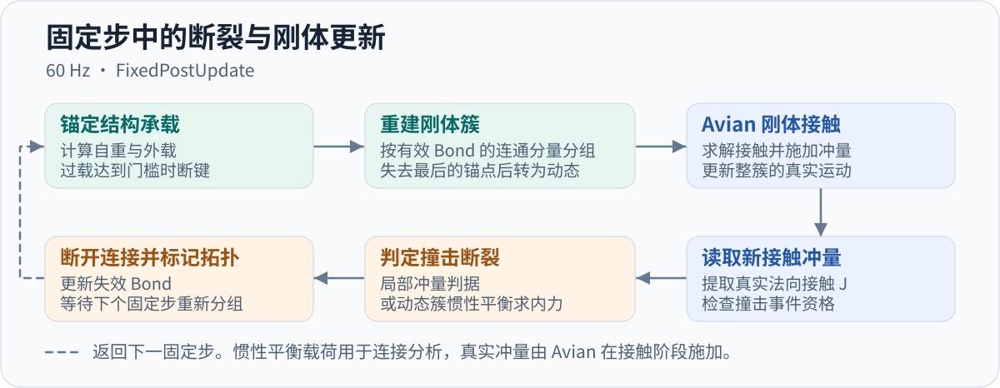

# Bevy Destruction 插件说明

Blender 离线把建筑划分为碎块，为相邻碎块生成承载连接，并标出固定支撑。Bevy 运行时维护这张结构图。图中每个连通分量对应一个 Avian 刚体簇。结构求解决定哪些连接失效，Avian 决定刚体簇如何运动及碰撞。场景操作和启动方式见[项目 README](../README.md)。

## 资产与结构图

资产入口是 `.destruction.json`。`DestructibleAsset` 保存解析后的 `Manifest` 和对应 GLB 的 `Handle<Gltf>`。加载器校验 v2 版本、米制右手 Y-up 坐标、结构引用和同目录 GLB 的 SHA-256。实例化时，插件通过 GLB 节点的碎块与源构件标识匹配几何，再读取材质的 `exterior` 或 `fracture` 角色。[资产格式](../tools/blender/ASSET_FORMAT.md) · [加载源码](../src/asset/mod.rs) · [实例化源码](../src/scene/mod.rs)

| 清单数据 | 用途 |
| --- | --- |
| `ChunkRecord` | 一个结构节点。保存稳定 ID、静止位姿、材料、烘焙质量属性和凸碰撞代理。一个碎块可有多个显示 primitive 或凸子体。 |
| `BondRecord` | 连接两个碎块的无向边。稳定 ID 标识整条连接，运行时以此记录是否断开。 |
| `BondPatchRecord` | 一条连接可有多个凸接触面片。每片保留顶点、法线、面积、中心和面积二阶矩，承载求解逐片计算。 |
| `AnchorRecord` | 将指定碎块标为 `fixed` 支撑。结构图通过存活碎块到锚点的可达性判定整簇是否受支撑。 |
| `PhysicalMaterial` | 提供密度、显示颜色、拉压剪强度、杨氏模量和泊松比。 |

显示网格、碰撞形状和连接各自承担独立职责。Avian 通过复合凸代理和材料密度计算碰撞质心、质量与惯性。清单的烘焙质量属性用于校验和制作审计，其中烘焙质心仍用于定位结构节点。两处质心存在偏移时，自重和撞击载荷会转换到结构节点处的等效力和力矩。[碰撞代理与质量属性](../src/scene/mod.rs) · [自重载荷](../src/stress_runtime/mod.rs) · [撞击载荷](../src/projectiles/mod.rs)

## 实例与刚体簇

同一清单可以实例化多栋建筑。每个碎块的存活状态在其 `ChunkInstance` 组件中，每条连接的端点实体和完好状态在 `BondInstance` 组件中。连接通过 `BondOfBuilding` 归属建筑，承载面片与显示面片通过 `PatchOfBond` 归属连接，分别引用清单凸面片和可共享的显示几何。建筑销毁时，其连接和面片自动销毁。建筑使用稳定 ID 索引碎块和连接，并记录显示面片的遍历顺序。固定步按需读取 ECS 状态生成求解快照。[场景实例](../src/scene/mod.rs) · [结构实体设计](notes/implemented/0023-ecs-structure-entities.md)

刚体簇通过 `ChildOf` 关联所属建筑。每栋建筑从自己的直属子实体中查询带 `Cluster` 的簇，碎块碰撞体的当前簇归属来自 Avian 的 `ColliderOf`。点击移除先标记碎块失效，固定步重建再解除其碰撞和归属。首次分簇前生成断裂反馈时使用建筑位姿。显示网格跟随碎块。[刚体簇](../src/physics/mod.rs)

计算连通分量时只纳入存活碎块及其间的有效连接。一个连通分量里仍有活的固定锚点时，整簇保持静态。失去最后一个锚点后，连通分量会成为动态刚体。普通接地和休眠由 Avian 管理，锚点始终来自资产。[连通分量](../src/structure/mod.rs) · [刚体重建](../src/physics/mod.rs)

运动中的簇分裂时，子簇沿用父簇的物理位姿和角速度。子簇质心的线速度为 `v子 = v父 + ω父 × (c子 − c父)`，其中两个质心取世界坐标。Avian 根据各子簇的碰撞体重新计算质量属性。这样，转动中位于簇边缘的碎块分离后可延续原先的切向运动。[速度继承](../src/physics/mod.rs) · [分簇回归](../src/physics/tests.rs)

## 承载与断裂

### 固定步

插件使用 60 Hz 固定模拟步。逐帧的点击逻辑读取准星命中，按可见几何选择命中块和至多五个相邻块，移除它们并关闭相关连接。固定步按下图处理承载、重建和接触。撞击在 Avian 接触求解后标记断键，下一固定步在进入 Avian 前应用新拓扑。[插件装配](../apps/game/src/lib.rs) · [点击破坏](../src/interaction/mod.rs)

### 自重和持续过载

锚定结构使用六自由度小变形弹性网络。每个节点有三个平移和三个转动自由度，固定锚点约束这些自由度。求解器根据各面片几何和材料刚度装配系统，施加自重及外载，再从解中恢复连接合力、力矩与承载率。承载率 `U` 取各面片拉、压、剪应力与相应强度比值的最大值，弯曲与扭转载荷计入应力恢复。[弹性求解](../src/stress/mod.rs) · [承载运行时](../src/stress_runtime/mod.rs)

外载由建筑实体上的可选 `StructuralLoads` 组件存储，按稳定碎块 ID 指定建筑坐标中的力和结构节点上的力矩。承载缓存及静态受力显示按建筑检查外载变更。[承载缓存](notes/implemented/0010-runtime-performance.md#决策与实现)

`U > 1` 时，累计损伤按 `Δt × (U − 1) / 0.5 s` 增长。默认损伤达到 1 或承载率达到 4 时，该键进入断裂候选，每栋建筑每步最多断开四条。数值失败的工况在后续步重试，并跳过对应的损伤更新。弹性位移用于诊断，可见结构按刚体簇运动。[渐进断裂实现](../src/stress_runtime/mod.rs) · [承载回归](../src/stress_runtime/tests.rs)

### 接触撞击和动态簇

Avian 已在接触阶段施加冲量。破坏系统读取新的有效接触，在法向接近速度达到 2 m/s 且合冲量非零时分析碰撞载荷。结构分析使用 `J / 10 ms` 将实际法向冲量标定为力，直接改变的是连接状态。撞击物自身保持刚性。[接触与资格判定](../src/projectiles/mod.rs)

- **局部路径**按有效面片面积分配命中碎块的冲量，用拉、压、剪判据提名断键。适用于静态簇、单块和需要回退的动态求解。
- **动态簇路径**按接触对汇总各碎块的冲量和冲量矩，扣除整簇的平移与转动惯性响应，再用平衡后的力和力矩求内部承载。一次求解可按应变能选择最多四条端点互不重叠的超限连接。簇仍连通时，下一次按更新后的图重算。原簇分开时，已求解的工况卸载。尚未求解的独立接触可在所有受载碎块仍同属一个动态子簇时首次绑定。

弹性网络提供准静态的连接载荷估计，断裂沿离线生成的接触边界发生。自由落体本身不会产生动态接触损伤，偏侧接触可以自然引起倾倒。[撞击断裂与接触事件](../src/projectiles/mod.rs) · [落地与卸载回归](../src/projectiles/tests.rs)

## 显示与诊断

接触面遮罩在源三角形上选择断面材质，邻块移走后露出破口。可选的骨料边带和烟尘由显示系统生成。受力热力按碎块所连有效 Bond 的最高承载率着色。局部详查列出最多三条连接及其合力、力矩和承载率，同时单独显示最近接触的真实冲量，冲量单位为 N·s。[接触面遮罩](../src/contact_mask/mod.rs) · [破口细节](../src/fracture_detail/mod.rs) · [受力显示](../src/force_debug/mod.rs)

## 源码入口

游戏包从 `apps/game/src/lib.rs` 引入 `src/` 下的功能模块，并通过 `DestructionPlugin` 安装 Avian、资产、场景、交互、诊断与特效插件。`asset_plugin()` 将资产目录解析到构建时工作区的 `assets/`，`parse_options()` 解析演示参数。ECS 架构导出调用游戏包的 `build_app()`，与桌面运行共用装配逻辑。无窗验收复用这一运行时，并单独配置离屏渲染和输入验证。[桌面装配](../apps/game/src/lib.rs) · [验收入口](../apps/acceptance/src/main.rs)
